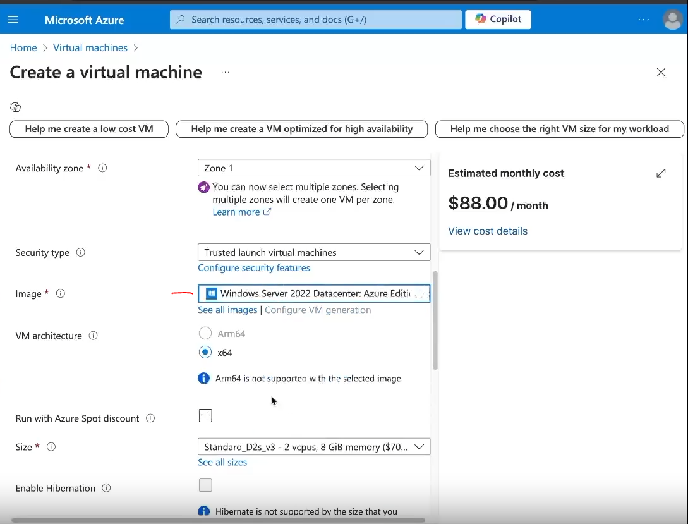
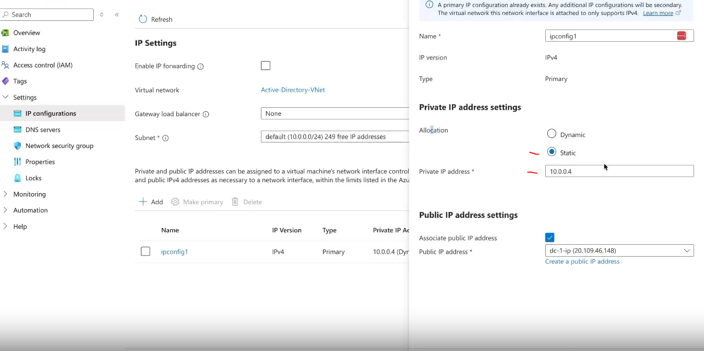
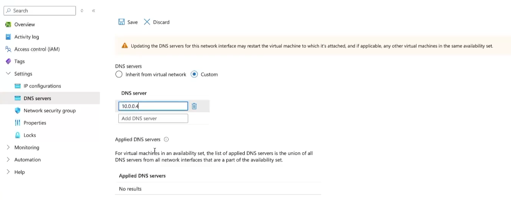
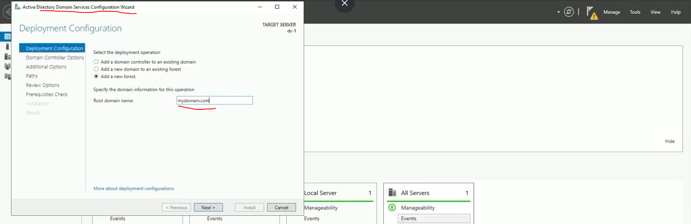
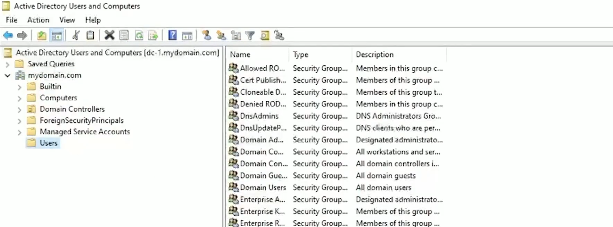
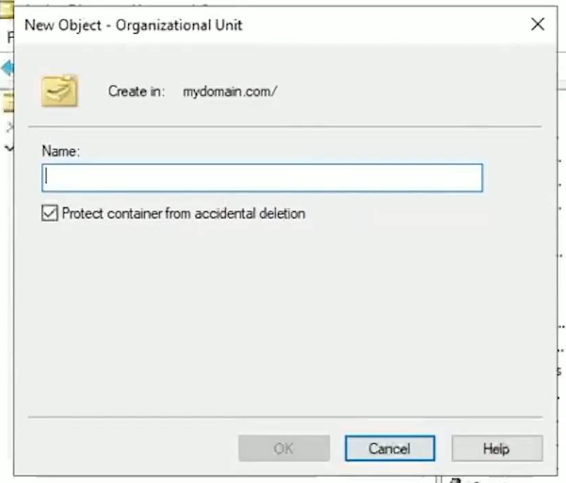
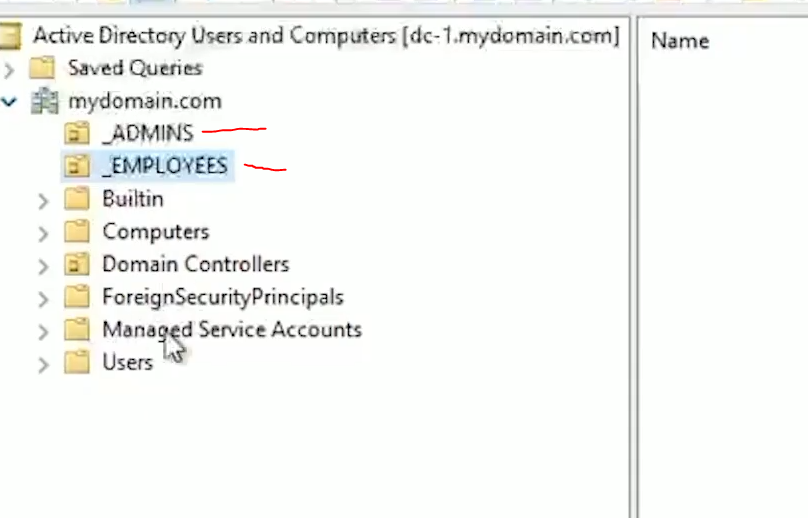
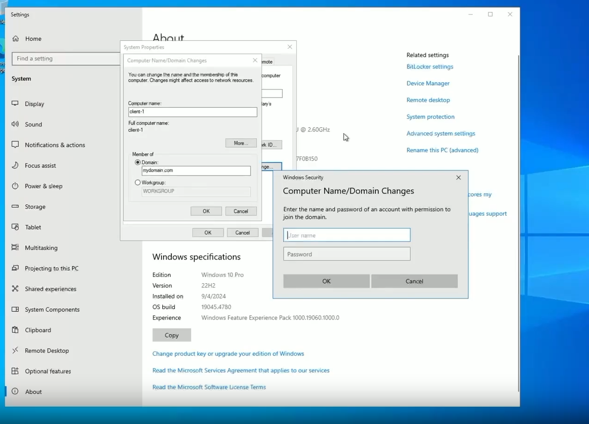
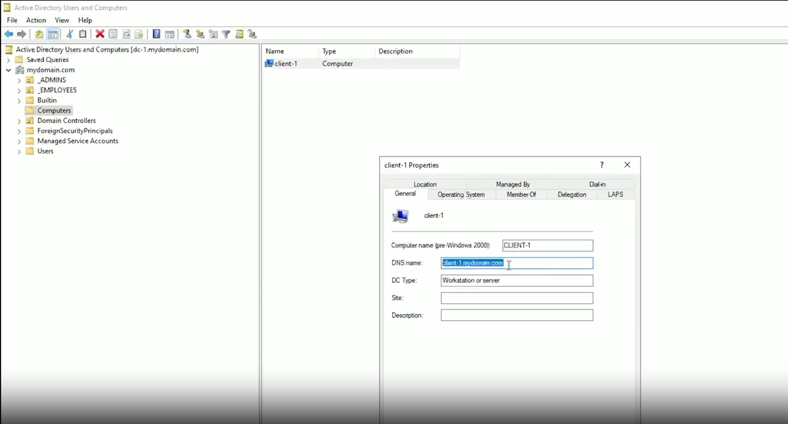

# Configure-AD

<h1>Configuring On-Premise Active Directory using Azure VMs</h1>
This tutorial outlines the setup of On-Premise Active Directory using Azure VMs. 

<h2>Environments and Technologies Used</h2>

- Microsoft Azure (Virtual Machines/Compute)
- Remote Desktop

<h2>Operating Systems Used </h2>

- Windows 11 pro</b>
- Windows Server 2022 Azure Ed.</b>

<h2>Steps</h2>

  First set up Microsoft VM set to Windows Server not Windows standard OS

After this set the Private IP to static, we do NOT want the IP address of the server to change. Here you can adjust IP settings such as name and address if you wish but make sure Static is checked.

 

  Change the DNS server to match the newly made server so the client now points to the domain

Now we can set up Remote Desktop for non-admin on main client

 

  Set up server onto Windows Server manager, promote our domain (DC-1) as our Domain controller.

  Set up DSRM Username and Pass.

 We need to make a new OU unit inside the active directory

   
  Under domains we should now have seperate folders made for _ADMINS and _EMPLOYEES
     

  We can add clients (users) into the domain through DNS 

 

